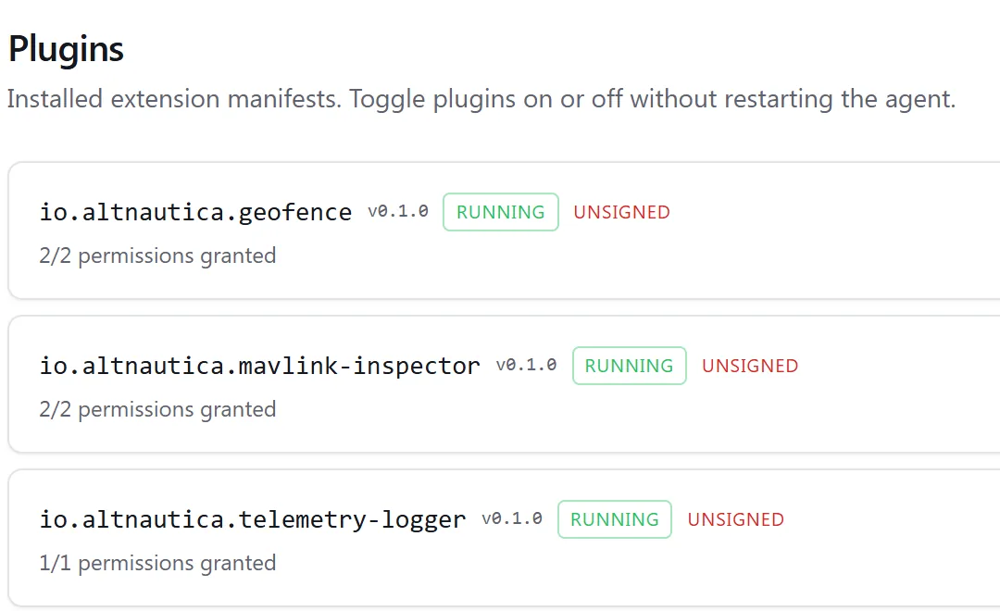
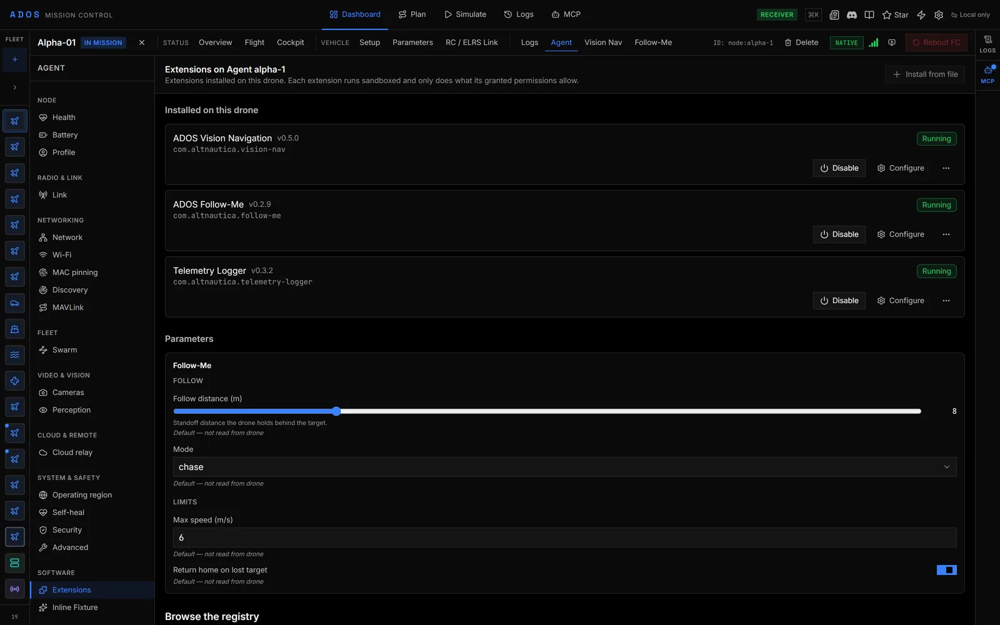
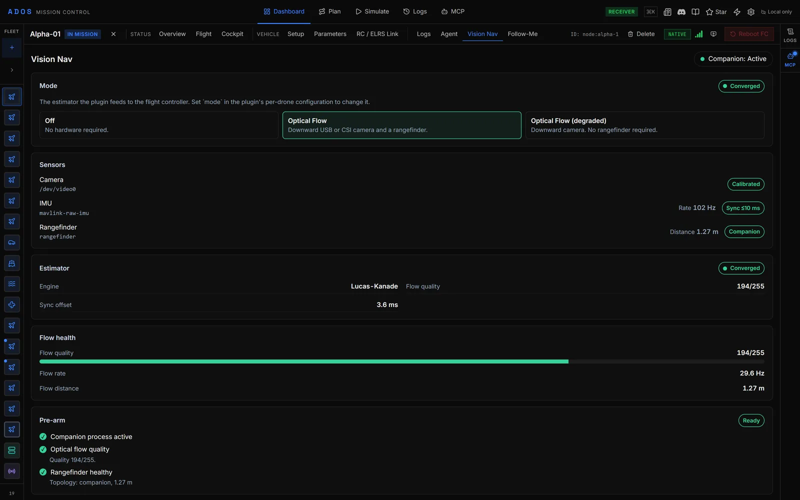
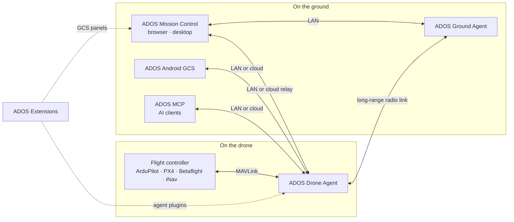

<p align="center">
  <a href="https://altnautica.com">
    <picture>
      <source media="(prefers-color-scheme: dark)" srcset=".github/assets/brand/altnautica-wordmark-dark.svg">
      
    </picture>
  </a>
</p>
<h1 align="center">ADOS Extensions</h1>
<p align="center"><em>First-party plugins for the ADOS Drone Agent and ADOS Mission Control.</em></p>
<p align="center">
  
  <a href="https://docs.rs/ados-sdk"></a>
  <a href="https://discord.gg/uxbvuD4d5q"></a>
</p>
<p align="center">
  <strong><a href="https://github.com/altnautica/ADOSMissionControl">Mission Control</a></strong> |
  <strong><a href="https://github.com/altnautica/ADOSDroneAgent">Drone Agent</a></strong> |
  <strong><a href="https://github.com/altnautica/ADOSAndroidGCS">Android GCS</a></strong> |
  <strong><a href="https://github.com/altnautica/ADOSExtensions">Extensions</a></strong> |
  <strong><a href="https://github.com/altnautica/ADOS-MCP">MCP</a></strong> |
  <strong><a href="https://github.com/altnautica/ADOSDroneAgent/tree/main/crates#published-crates">Rust crates</a></strong> |
  <strong><a href="https://docs.altnautica.com">Docs</a></strong> |
  <strong><a href="https://altnautica.com">Website</a></strong> |
  <strong><a href="https://discord.gg/uxbvuD4d5q">Discord</a></strong>
</p>
<p align="center">
  <a href="https://docs.altnautica.com/developers/overview">Developer Docs</a> ·
  <a href="https://docs.rs/ados-sdk">Rust SDK</a> ·
  <a href="https://github.com/altnautica/ADOSExtensions/issues">Issues</a>
</p>

<p align="center">
  <picture>
    <source media="(prefers-color-scheme: dark)" srcset=".github/assets/screens/drone-plugins-catalog-dark.webp">
    
  </picture>
</p>

ADOS is an open-source platform for software-defined drones, and extensions are how it grows. This repo holds the first-party extensions: subject following, GPS-denied vision navigation, gimbal and camera-pod drivers, and World Engine (in beta) for 3D world models and perception offload. They are built with the same SDKs and plugin system that are open to everyone, so anything here is something you can build too.

An extension adds a capability to ADOS without forking it: a new panel in Mission Control, a driver for a sensor or gimbal on the drone, or a behavior that spans both. Each one ships as a single signed `.adosplug` archive that an operator installs from the Plugins tab or the agent CLI, with the permissions it needs shown up front. One manifest describes both halves: the agent half runs as a supervised subprocess on the ADOS Drone Agent (Python or Rust), and the GCS half renders as React panels in a sandboxed iframe in ADOS Mission Control.

## Two ways in

**Run an extension (operator).** From Mission Control, open a drone, switch to the **Plugins** tab, pick an extension, and approve the install. The agent downloads the signed archive, verifies the signature, and stages the plugin under its supervisor. No SSH, no rebuild.

**Build an extension (developer).** Scaffold a plugin with `create-ados-plugin`, write the GCS half in TypeScript and the agent half in Python or Rust against the SDKs, then pack and sign it into a `.adosplug`. The same plugin system powers both first-party and community extensions.

## In Mission Control

<table>
  <tr>
    <td width="50%">
      <picture>
        <source media="(prefers-color-scheme: dark)" srcset=".github/assets/screens/drone-plugins-installed-dark.webp">
        
      </picture>
      <p align="center"><a href="https://docs.altnautica.com/mission-control/installing-plugins">Installed plugins</a></p>
    </td>
    <td width="50%">
      
      <p align="center"><a href="https://docs.altnautica.com/developers/gcs-plugin-deep-dive">Extension panels in Mission Control</a></p>
    </td>
  </tr>
  <tr>
    <td width="50%">
      
      <p align="center"><a href="https://docs.altnautica.com/drone-agent/vision-nav-install">Vision Navigation</a></p>
    </td>
    <td width="50%">
      <picture>
        <source media="(prefers-color-scheme: dark)" srcset=".github/assets/screens/drone-plugins-catalog-dark.webp">
        
      </picture>
      <p align="center"><a href="https://docs.altnautica.com/drone-agent/extensions-catalog">Extension catalog</a></p>
    </td>
  </tr>
</table>

## Extensions

| Extension | Name | Kind | What it adds |
|-----------|------|------|--------------|
| [follow-me](extensions/follow-me/README.md) | ADOS Follow-Me | Agent + GCS | Operator-designated subject follow at a fixed standoff via guided setpoints, with a lock-state safety gate |
| [mavlink-gimbal-v2](extensions/mavlink-gimbal-v2/README.md) | ADOS MAVLink Gimbal v2 Controller | Agent + GCS | MAVLink Gimbal v2 manager control, region-of-interest lock, and an aim-at-target visual servo with a lock-state safety gate |
| [siyi-pod](extensions/siyi-pod/README.md) | ADOS SIYI Optical Pod | Agent + GCS | Native SIYI optical-pod driver with per-model capability negotiation: gimbal, zoom, thermal, and a laser rangefinder with subject geolocation |
| [thermal-camera-flir-lepton-usb](extensions/thermal-camera-flir-lepton-usb/README.md) | ADOS Thermal Camera FLIR Lepton USB UVC | Agent + GCS | FLIR Lepton 3.5 radiometric driver, palettes and spot metering with a GCS overlay. The capture path needs a UVC backend that this repository does not include, so it reports an explicit unavailable state instead of producing readings |
| [vision-nav](extensions/vision-nav/README.md) | ADOS Vision Navigation | Agent (Rust) + GCS | GPS-denied navigation from downward optical flow, with a camera-IMU calibration check and an advisory pre-arm status |
| [world-engine](extensions/world-engine/README.md) | ADOS World Engine | Agent (Rust) + GCS | Beta. 3D world model from drone flights, reconstructed on a LAN compute node from keyframes posed by the flight controller, visual-inertial odometry or LiDAR SLAM, plus perception offload for drones without an NPU |

These extensions are under active development and grow with every release; build on them, or start your own, with the SDKs below.

## How ADOS fits together



ADOS Ground Agent is the Drone Agent running its ground-station profile.

<!-- ados-family:repos -->
| Repo | Runs on | What it does | Link |
|---|---|---|---|
| ADOS Mission Control | Browser, desktop (Electron) | Ground control station: FC setup, mission planning, flight, 3D simulation, fleet | [ADOSMissionControl](https://github.com/altnautica/ADOSMissionControl) |
| ADOS Drone Agent | Companion computer on the drone, or a ground node | Onboard agent: MAVLink routing, HD video, long-range radio link, plugins, remote control | [ADOSDroneAgent](https://github.com/altnautica/ADOSDroneAgent) |
| ADOS Android GCS | Android phones and tablets | Native ground control app for agents on the LAN, direct flight controllers and the cloud | [ADOSAndroidGCS](https://github.com/altnautica/ADOSAndroidGCS) |
| ADOS Extensions | Drone Agent and Mission Control | First-party signed plugins, each with an agent half and a GCS half | [ADOSExtensions](https://github.com/altnautica/ADOSExtensions) |
| ADOS MCP | Your machine | Model Context Protocol server that lets AI clients operate ADOS drones under scopes and a safety gate | [ADOS-MCP](https://github.com/altnautica/ADOS-MCP) |
| Documentation | docs.altnautica.com | Public docs for every ADOS product | [Documentation](https://github.com/altnautica/Documentation) |
<!-- /ados-family:repos -->

### ADOS Rust crates

Reusable libraries from the ADOS Drone Agent, published on crates.io. Versioning and licences: [crates index](https://github.com/altnautica/ADOSDroneAgent/tree/main/crates#published-crates).

<!-- ados-family:crates -->
**Platform (versioned with the ADOS Drone Agent)**

| Crate | What it does | Docs |
|---|---|---|
| [`ados-protocol`](https://crates.io/crates/ados-protocol) | Wire contracts of the ADOS Drone Agent: IPC framing, plugin RPC envelope, capability tokens and the vision frame bus. | [docs.rs](https://docs.rs/ados-protocol) |
| [`ados-sdk`](https://crates.io/crates/ados-sdk) | Write Rust plugins for the ADOS Drone Agent: IPC client, plugin context, driver traits and lifecycle runner. | [docs.rs](https://docs.rs/ados-sdk) |
| [`ados-vision`](https://crates.io/crates/ados-vision) | Single-object visual tracker: Kalman motion model, appearance re-identification and YOLOv8 head decoding. | [docs.rs](https://docs.rs/ados-vision) |
| [`ados-gpio`](https://crates.io/crates/ados-gpio) | Drive status buzzers and LEDs on Linux GPIO lines, with bounded software-PWM beep patterns. | [docs.rs](https://docs.rs/ados-gpio) |
| [`ados-hal-probe`](https://crates.io/crates/ados-hal-probe) | Find out what a board's hardware can really do by probing it, plus bundled board profiles. | [docs.rs](https://docs.rs/ados-hal-probe) |

**Standalone**

| Crate | What it does | Docs |
|---|---|---|
| [`ados-sensorhub`](https://crates.io/crates/ados-sensorhub) | Sensor hub wire protocol: COBS framing, CRC-16 and fixed-layout IMU, baro, mag and GNSS packets. no_std. | [docs.rs](https://docs.rs/ados-sensorhub) |
| [`ados-offload`](https://crates.io/crates/ados-offload) | Choose where perception runs (onboard, offloaded or hybrid) and hold the vehicle when results go stale. | [docs.rs](https://docs.rs/ados-offload) |
| [`ados-macpin`](https://crates.io/crates/ados-macpin) | Stable MAC addresses for Linux network adapters that randomize theirs every boot. | [docs.rs](https://docs.rs/ados-macpin) |
| [`ados-lora`](https://crates.io/crates/ados-lora) | LoRa transmit governor with cited regional band plans, duty cycle, dwell time and airtime accounting. | [docs.rs](https://docs.rs/ados-lora) |
| [`ados-crsf-codec`](https://crates.io/crates/ados-crsf-codec) | no_std CRSF / ExpressLRS codec for RC channels, telemetry and parameter frames. | [docs.rs](https://docs.rs/ados-crsf-codec) |
| [`ados-positioning`](https://crates.io/crates/ados-positioning) | Split mixed UBX, NMEA and RTCM3 GNSS streams, configure u-blox receivers and run an RTK base survey-in. | [docs.rs](https://docs.rs/ados-positioning) |
| [`ados-rtcm`](https://crates.io/crates/ados-rtcm) | RTCM3 framing, CRC-24Q and MAVLink GPS_RTCM_DATA fragmentation for RTK corrections. | [docs.rs](https://docs.rs/ados-rtcm) |
| [`ados-clock`](https://crates.io/crates/ados-clock) | Map remote clocks onto the host clock: least-squares and envelope fits, TIMESYNC and a chrony sink. | [docs.rs](https://docs.rs/ados-clock) |
| [`ados-swarm`](https://crates.io/crates/ados-swarm) | Swarm control laws: separation, flocking, formations, CBBA task allocation and a point-mass simulator. | [docs.rs](https://docs.rs/ados-swarm) |
| [`ados-mavlink-tunnel`](https://crates.io/crates/ados-mavlink-tunnel) | Send large messages over MAVLink TUNNEL frames with chunking and bounded reassembly. | [docs.rs](https://docs.rs/ados-mavlink-tunnel) |
| [`ados-display-driver`](https://crates.io/crates/ados-display-driver) | Small-display output on Linux: SSD1306/SH1106 OLED over I2C, pixel packers and a framebuffer writer. | [docs.rs](https://docs.rs/ados-display-driver) |
| [`ados-hmi`](https://crates.io/crates/ados-hmi) | Front-panel input: touchscreen calibration and gestures, button presses and rotary encoders. | [docs.rs](https://docs.rs/ados-hmi) |
<!-- /ados-family:crates -->

## Toolkit

Packages an extension author builds against:

| Package | Use |
|---------|-----|
| `create-ados-plugin` | Scaffolder. `npx create-ados-plugin` with GCS-only, agent-only, or hybrid templates |
| `plugin-sdk` | TypeScript SDK for the GCS half: telemetry hooks, postMessage RPC to the agent, and a test harness |
| `extension-ui` | Reusable React UI primitives that match the Mission Control theme |
| [`ados-sdk`](https://crates.io/crates/ados-sdk) | Rust SDK for the agent half, on crates.io ([docs.rs](https://docs.rs/ados-sdk)) |

## Repo layout

```
extensions/                        first-party extensions, versioned independently
  follow-me/
  mavlink-gimbal-v2/
  siyi-pod/
  thermal-camera-flir-lepton-usb/
  vision-nav/
  world-engine/
packages/
  create-ados-plugin/              scaffolder + templates
  plugin-sdk/                      TypeScript GCS SDK
  extension-ui/                    shared React UI primitives
scripts/
  pack.sh                          build + manifest hash + zip to .adosplug
  pack-rust.sh                     same, for an extension whose agent half is a crate
  _pack-exclude.sh                 shared packing helpers: archive excludes, entrypoint guard
  build-rust.sh                    cross-compile a Rust agent half
  pack-world-engine-local.sh       build, pack and sign a World Engine archive for bench tests
  world-engine-payloads.tsv        World Engine release payloads fetched at install
  lint-manifest.mjs                check a manifest against the code it describes
  lint-fixtures/                   fixtures for the manifest linter
  emit-reference.mjs               write docs/reference/extensions.json from the manifests
  sign.sh                          Ed25519-sign the archive against the publisher key
  submit.sh                        submit a signed archive to a plugin registry
  registry_submit_fields.py        derive registry submission fields from a signed archive
  tests/                           tests for the packing, signing and submission scripts
.github/workflows/
  extensions.yml                   per-extension build and test on pull requests and main
  typecheck.yml                    TypeScript typecheck on pull requests and main
  rust-check.yml                   check the Rust agent halves
  reference.yml                    keep docs/reference/extensions.json in sync
  release.yml                      build, sign, and release on tag push
  vision-nav-release.yml           Vision Navigation release pipeline
  world-engine-release.yml         World Engine release pipeline
  world-engine-deep.yml            on-demand deep World Engine test run
```

`pnpm-workspace.yaml` declares the GCS halves and root tooling (run `pnpm install` at the repo root). `pyproject.toml` declares the agent halves and shared Python utilities. Each extension carries its own `CHANGELOG.md` and is versioned independently through its own release tags.

## Building one extension

```sh
cd extensions/mavlink-gimbal-v2
pnpm install
pnpm build
../../scripts/pack.sh mavlink-gimbal-v2
```

This produces `dist/com.altnautica.mavlink-gimbal-v2-<version>.adosplug`. The archive layout matches the public extension spec at [docs.altnautica.com/developers/manifest](https://docs.altnautica.com/developers/manifest).

`pack.sh` refuses to write a half-archive: if the manifest declares a GCS entrypoint the built bundle has to be in the archive, and if it declares a Python `agent.entrypoint` the module that entrypoint names has to be there too. An archive with no agent source installs cleanly and verifies, then the supervisor dies importing a module that was never packed.

Check a manifest against the code it describes before you pack:

```sh
node scripts/lint-manifest.mjs extensions/mavlink-gimbal-v2/manifest.yaml
```

It fails on a declared permission with no call site, a declared UI slot with no implementation, and a version that disagrees across `manifest.yaml`, the two `package.json` files and the `definePlugin({ version })` literal the host registers.

## Building a Rust extension

The Rust agent SDK is [`ados-sdk`](https://crates.io/crates/ados-sdk), published on crates.io with API docs on [docs.rs](https://docs.rs/ados-sdk). An out-of-tree plugin adds it with `cargo add ados-sdk`; its version tracks the agent release it targets. See the [Rust SDK guide](https://docs.altnautica.com/developers/sdk-rust).

First-party extensions in this repo (`vision-nav`, `world-engine`) build against a sibling agent checkout instead, so the two repositories have to sit next to each other:

```
<root>/ADOSDroneAgent
<root>/ADOSExtensions
```

`Cargo.toml` uses a path dependency on that sibling for local development. CI clones the agent repository and checks out the revision in the repo-root `ADOS_AGENT_REV` file, so a release tag resolves the SDK at a fixed commit rather than whatever `main` happened to be. Update `ADOS_AGENT_REV` when a release needs a newer SDK.

Cross-compiling for a drone needs the musl target and an aarch64 musl linker. Apple's `ld` is not one, so a plain macOS build compiles everything and then fails at the link step; `scripts/build-rust.sh` documents the linker env vars, including a `zig cc` fallback where no musl toolchain is installed.

```sh
rustup target add aarch64-unknown-linux-musl
./scripts/pack-rust.sh vision-nav
```

`pack-rust.sh` asserts both halves are in the archive before it zips: the compiled binary at the manifest's `agent.entrypoint` and, when one is declared, the built GCS bundle.

## Signing

Tagged releases run `scripts/sign.sh` in CI against the publisher key. The signed archive is published as a GitHub Release asset and, for first-party extensions, surfaces inside the Mission Control Plugins tab through the hosted registry.

## Installing on a drone

From Mission Control: open a drone, switch to the **Plugins** tab, browse the registry, pick the extension, and approve the two-stage install dialog. The agent downloads the signed archive, verifies the Ed25519 signature, and stages the plugin under its supervisor.

From the agent CLI:

```bash
ados plugin install https://github.com/altnautica/ADOSExtensions/releases/download/<release>/<extension>.adosplug
```

## Community

Questions, ideas and show-and-tell go in [Discord](https://discord.gg/uxbvuD4d5q). Bugs and feature requests go in [Issues](https://github.com/altnautica/ADOSExtensions/issues).

## Contributing

First-party only at launch. Community contributions land through the hosted registry submission flow when the registry reaches v1.0. See the [hosted registry developer doc](https://docs.altnautica.com/developers/distribution-registry) for the policy, and the [developer docs](https://docs.altnautica.com/developers/overview) for the manifest, SDKs, and permission model.

## License

[GPL-3.0-or-later](LICENSE). Each extension is free to use, modify, and distribute under the same terms. The Rust `ados-sdk` crate on crates.io is MIT OR Apache-2.0.
